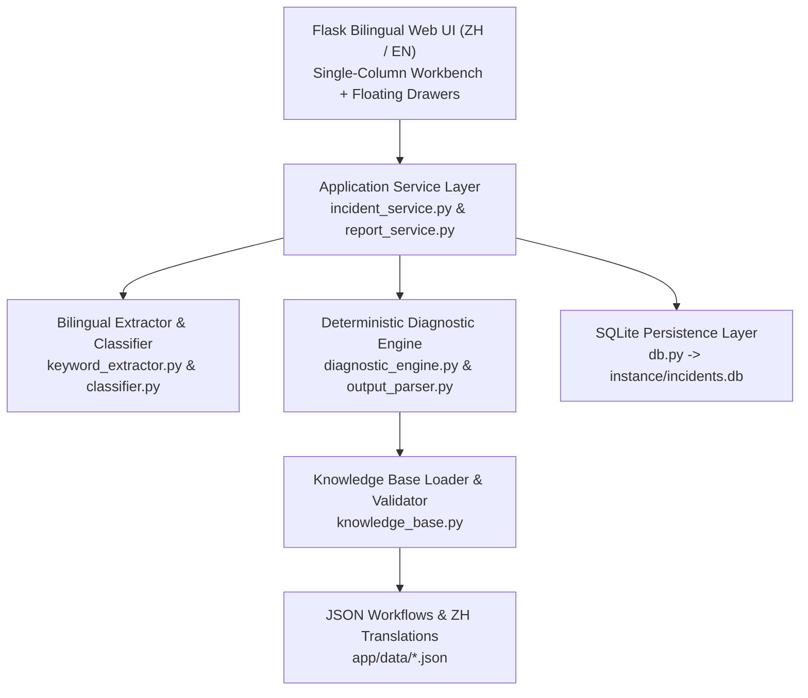

# IT Support Diagnostic & Case Management System

> **Evidence-based, deterministic, cross-OS (Windows / Linux / macOS) IT troubleshooting platform, learning tool, and L1-to-L2 escalation handoff system.**  
> 證據導向、跨作業系統（Windows / Linux / macOS）的規則引擎 IT 支援診斷、學習筆記與案件交接系統（支援繁體中文 / English 雙語介面）。

---

## Why This Project? (How It Differs from Generic AI Chatbots)

Generic AI chatbots generate one-off text suggestions that are hard to audit, easy to hallucinate, and fragmented across chat logs. This system is engineered as a **deterministic, data-driven IT support workbench** without relying on external AI APIs:

| Capability | Generic AI Chatbot | This Diagnostic Platform |
|---|---|---|
| **Decision Logic** | Probabilistic text generation | Deterministic Python state machine driven by validated JSON schemas |
| **Evidence vs. Root Cause** | Often mixes guesses with facts | Strictly separates `Symptom` → `Test` → `Evidence` → `Evidence-Supported Finding` → technician-verified `Confirmed Root Cause` |
| **Terminal Output Analysis** | Unstructured prompt pasting | Built-in regex parser (`output_parser.py`) deterministically extracts IPv4, APIPA (`169.254.x.x`), gateway, packet loss, and latency across Windows / Linux / macOS |
| **Safety Controls** | Text disclaimers only | Priority `safety_stop` override immediately halts workflows on electrical/thermal/swollen-battery red flags; commands carry explicit `read_only` vs. `system_change` risk badges |
| **L1 → L2 Ticket Handoff** | Messy chat transcripts | One-click structured **Markdown** & **Printable HTML** handoff reports listing steps performed, parsed evidence, and ruled-out causes |

---

## Implemented Features (MVP)

### 1. Cross-OS Diagnostic Knowledge Base (`app/data/`)
Diagnostic workflows are completely decoupled from Python engine logic and validated against [workflow_schema.json](app/data/workflow_schema.json) on startup (ID uniqueness, valid transition targets, BFS reachability, cycle detection, and required fallback transitions):
- **`NET-001` — No Internet Connectivity (Cross-OS)**: 6-step OSI Layer 1–7 troubleshooting with side-by-side Windows (`ipconfig`, `netsh`, `nslookup`), Linux (`nmcli`, `ip a && ip r`, `dig`), and macOS (`networksetup`, `ifconfig`, `route`, `scutil --dns`) commands.
- **`HW-001` — PC Does Not Power On / No Display**: 5-step safety-first hardware workflow with strict PSU/ESD precautions, residual power drain, and mandatory `safety_stop` triggers (smoke/burning smell, swollen battery, liquid spill).
- **`OS-001` — Slow System Performance & High Resource Usage (Cross-OS)**: 5-step bottleneck isolation branching into CPU, RAM/Swap, Disk Space/I/O, and OS System Logs (`Event Viewer`, `journalctl`, `Console` / `log show`).

### 2. Bilingual Support (繁體中文 / English)
- Instant **繁體中文 / English** language toggle in the web UI (`app/i18n.py` + `app/data/translations_zh.json` overlay pack — terminal commands remain intact while instructions, outcomes, and learning notes localize cleanly).
- Bilingual deterministic keyword extractor and rule-based classifier (`app/diagnostic/keyword_extractor.py`, `app/diagnostic/classifier.py`) supporting English and Traditional Chinese (including common Hong Kong IT terminology). Ambiguous or unsupported inputs are never force-classified.

### 3. Lightweight Cross-OS Command Output Parser
- Paste raw output from Windows `ipconfig /all`, Linux `ip a && ip r`, macOS `ifconfig`, or `ping` on any of the three OSes.
- `app/diagnostic/output_parser.py` deterministically extracts structured metrics (IPv4, APIPA detection, default gateway, interface-down state, packet loss %, average latency), records them as traceable evidence, and highlights the suggested outcome in the UI.

### 4. Focused Single-Column Workbench & Floating Drawers
- **Focused Step UI**: Presents one primary diagnostic step at a time with command risk badges (`Read-Only`, `System Change`, `Destructive`) and copyable commands.
- **Floating Learning Notes (`📘 學習筆記`)**: On-demand slide-over drawer explaining *why this step matters*, *underlying technical principles*, *test limitations*, and **side-by-side Windows / Linux / macOS command equivalents**.
- **Floating Diagnostic Progress (`🧭 診斷進度`)**: On-demand drawer tracking completed steps and evidence-backed ruled-out causes.

### 5. SQLite Case Persistence & L1-to-L2 Handoff Reports
- Every incident, diagnostic session, step execution, evidence record, ruled-out cause, and finding is durably persisted in SQLite (`app/database/db.py`, `app/services/incident_service.py`).
- `app/services/report_service.py` generates copy-paste-ready **Markdown** reports (for Jira / ServiceNow), downloadable `.md` files, and self-contained **Printable HTML** reports, plus a technician resolution form for explicit root-cause confirmation.

---

## System Architecture



### Project Structure

```text
IT_Support_Diagnostic_Assistant/
├── AGENTS.md                        # Project engineering & safety baseline
├── README.md
├── requirements.txt
├── run.py                           # Local Flask entry point
├── docs/                            # Product spec, architecture, KB design, progress
├── app/
│   ├── __init__.py                  # Flask app factory (create_app)
│   ├── i18n.py                      # ZH / EN UI translations
│   ├── routes.py                    # Web routes & /api/parse-output endpoint
│   ├── diagnostic/
│   │   ├── keyword_extractor.py     # Bilingual symptom/OS/safety extractor
│   │   ├── classifier.py            # Rule-based category & workflow classifier
│   │   ├── output_parser.py         # Cross-OS regex parser (ip_config, ping)
│   │   └── diagnostic_engine.py     # State machine, branching, max_visits, safety_stop
│   ├── knowledge/
│   │   └── knowledge_base.py        # JSON loader, schema/graph validator, OS resolver
│   ├── database/
│   │   └── db.py                    # SQLite schema & transactional manager
│   ├── services/
│   │   ├── incident_service.py      # Incident & session lifecycle orchestration
│   │   └── report_service.py        # Markdown & printable HTML handoff reports
│   ├── data/
│   │   ├── workflow_schema.json     # Formal JSON Schema contract
│   │   ├── network_rules.json       # NET-001 (Cross-OS)
│   │   ├── hardware_rules.json      # HW-001 (Safety-first hardware)
│   │   ├── os_rules.json            # OS-001 (Cross-OS performance)
│   │   └── translations_zh.json     # Traditional Chinese workflow overlay
│   ├── templates/                   # Jinja2 HTML templates
│   └── static/                      # CSS & vanilla JavaScript
├── tests/                           # 49 Pytest unit & integration tests
└── instance/                        # Local SQLite database directory (gitignored)
```

---

## Tech Stack

- **Backend:** Python 3.11, Flask 3, SQLite3 (stdlib)
- **Knowledge Base:** Structured JSON + custom graph/schema validator
- **Frontend:** Jinja2 HTML, CSS, Vanilla JavaScript (zero heavy frontend frameworks)
- **Testing:** Pytest (49 automated unit & integration tests)
- **External AI APIs:** None required

---

## Quick Start (Run Locally)

### 1. Clone and set up a virtual environment

```powershell
git clone https://github.com/anson7875/IT_Support_Diagnostic_Assistant.git
cd IT_Support_Diagnostic_Assistant
python -m venv .venv
.\.venv\Scripts\pip install -r requirements.txt
```

*(macOS / Linux: use `source .venv/bin/activate` and `pip install -r requirements.txt`)*

### 2. Start the web application

```powershell
.\.venv\Scripts\python run.py
```

Open **http://127.0.0.1:5000** in your browser. Use the quick demo chips on the homepage to test macOS networking (with APIPA output parsing), Windows hardware safety-stop, or Linux performance diagnostics.

### 3. Run the automated test suite

```powershell
.\.venv\Scripts\python -m pytest -v
```

Current verified test coverage: **49 passed** across:
- `tests/test_knowledge_base.py` (schema validation, reachability, cycle detection, cross-OS resolution)
- `tests/test_output_parser.py` (Windows/Linux/macOS `ipconfig`/`ip a`/`ifconfig`/`ping` parsing)
- `tests/test_diagnostic_engine.py` (branching, evidence append-only, `max_visits` guard, `safety_stop` override)
- `tests/test_classifier.py` (English & Traditional Chinese extraction, ambiguous/unsupported handling)
- `tests/test_incident_and_report.py` (SQLite persistence, Markdown & printable HTML handoff reports)
- `tests/test_web_routes.py` (Flask routes, bilingual toggle, `/api/parse-output`, end-to-end session flow)

---

## Planned Future Enhancements (Feature Branches)

- Additional JSON workflows (RAM/Storage diagnostics, BSOD/Kernel Panic, DNS deep-dive)
- Additional command parsers (e.g., `nslookup` / `dig`, `df -h`, `free -h`)
- Optional Traditional Chinese report export alongside English L1→L2 reports
- GitHub Actions CI workflow for automated Pytest runs on pull requests
