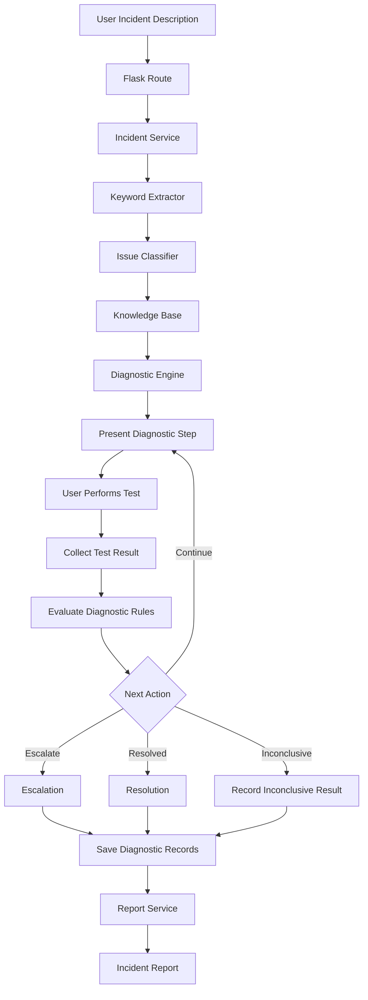

# IT Support Diagnostic & Case Management System

**Document Type:** System Architecture  
**Version:** 1.1  
**Project Status:** Design Aligned (Pre-Schema Validation)

---

## 1. Architecture Overview

### 1.1 Architectural Approach

The application will adopt a modular layered architecture.

Each module will have a clearly defined responsibility to improve maintainability, testability, extensibility, and separation of concerns.

The initial implementation will be a Python Flask application using SQLite for persistent storage and JSON files for diagnostic knowledge.

The system will not require external AI APIs for core diagnostic operations.

### 1.2 Architectural Layers

The application consists of five logical layers:

1. Presentation Layer
2. Application / Service Layer
3. Diagnostic Engine Layer
4. Knowledge Layer
5. Data Layer

#### Presentation Layer

Responsible for user interaction and presentation.

Technologies:

- Flask
- HTML
- CSS
- JavaScript

Responsibilities:

- Accept incident descriptions.
- Display diagnostic instructions.
- Collect diagnostic responses.
- Display findings and warnings.
- Present incident history.
- Display generated reports.

#### Application / Service Layer

Responsible for coordinating application workflows.

Main modules:

- incident_service.py
- report_service.py

Responsibilities:

- Coordinate incident creation and updates.
- Coordinate diagnostic workflow operations.
- Manage incident status.
- Organize diagnostic records.
- Prepare data for incident reports.

#### Diagnostic Engine Layer

Responsible for diagnostic processing and rule evaluation.

Main modules:

- keyword_extractor.py
- classifier.py
- output_parser.py
- diagnostic_engine.py
- troubleshooting.py

Responsibilities:

- Extract relevant information from incident descriptions.
- Classify incident categories.
- Parse pasted terminal outputs for supported commands into structured observations.
- Select diagnostic workflows.
- Execute diagnostic steps (adapting instructions to target OS: Windows, Linux, macOS).
- Evaluate test results and outcome selections.
- Determine conditional branches.
- Identify escalation and safety-stop conditions.

#### Knowledge Layer

Responsible for maintaining diagnostic knowledge independently from application logic.

Main modules and data:

- knowledge_base.py
- app/data/hardware_rules.json
- app/data/os_rules.json
- app/data/network_rules.json

Responsibilities:

- Load diagnostic knowledge.
- Validate knowledge structures.
- Retrieve workflows and diagnostic steps.
- Provide expected results and conditional rules.
- Provide safety warnings and technical references.

#### Data Layer

Responsible for persistent data storage and retrieval.

Main modules:

- models.py
- db.py

Technology:

- SQLite

Responsibilities:

- Store incidents.
- Store diagnostic sessions.
- Store diagnostic step results.
- Store evidence records.
- Store findings and resolutions.
- Retrieve historical records.

---

## 2. High-Level System Flow

The normal diagnostic process follows this sequence:

1. User submits an incident description.
2. Flask route receives the request.
3. Incident service creates an incident record.
4. Keyword extractor identifies relevant information.
5. Classifier determines the likely issue category.
6. Knowledge base retrieves an appropriate workflow.
7. Diagnostic engine initializes the workflow.
8. Troubleshooting component presents the next diagnostic step.
9. User performs the test and submits a result.
10. Diagnostic engine evaluates the result against predefined rules.
11. The system selects the next step or escalation action.
12. Test results and evidence are recorded.
13. The process continues until resolution, escalation, or termination.
14. Report service generates a structured incident report.

### 2.1 Diagnostic Flow Diagram



---

## 3. Module Responsibilities

### 3.1 keyword_extractor.py

Purpose:

Extract relevant technical information from user-provided incident descriptions.

Potential information:

- Device type
- Symptoms
- Error messages
- Operating system
- Hardware components
- Network-related terms
- Recent changes
- Frequency indicators

Input:

Natural-language incident description.

Output:

A structured representation of extracted information.

The initial implementation will use deterministic text-processing techniques rather than external AI services.

### 3.2 classifier.py

Purpose:

Classify incidents into supported technical categories.

Initial categories:

- Hardware (`hardware`)
- Operating Systems (`os` — Windows, Linux, macOS)
- Networking (`network` — cross-OS)

Input:

Incident description and extracted information.

Output:

Classification result, including category and confidence or matching information.

The classifier should support ambiguous and unsupported incidents without forcing an incorrect classification.

### 3.2.1 output_parser.py

Purpose:

Provide lightweight, deterministic parsing of raw terminal command outputs pasted by the user (e.g., `ping`, `ipconfig`, `ifconfig`, `ip a`).

Input:

Command type (parser key), target OS, and raw terminal output text.

Output:

Structured extracted metrics (e.g., IP address, APIPA flag, packet loss percentage, average latency), suggested normalized result code, and parsing notes. If output cannot be reliably parsed, returns an `inconclusive` suggestion without guessing.

### 3.3 diagnostic_engine.py

Purpose:

Control diagnostic workflow execution and conditional decision-making.

Responsibilities:

- Initialize a diagnostic session.
- Retrieve the current workflow step.
- Evaluate submitted test results.
- Apply conditional rules.
- Select the next diagnostic step.
- Identify terminal and escalation conditions.

Input:

Workflow definition, current diagnostic state, and submitted test result.

Output:

Next diagnostic action and updated diagnostic state.

The engine must produce deterministic results for the same workflow state and input.

### 3.4 troubleshooting.py

Purpose:

Manage the interaction between diagnostic workflows and the presentation layer.

Responsibilities:

- Prepare diagnostic step information.
- Present step instructions.
- Collect user responses.
- Coordinate diagnostic step transitions.

The module should not duplicate the core rule-evaluation logic owned by diagnostic_engine.py.

### 3.5 knowledge_base.py

Purpose:

Provide structured diagnostic knowledge to the application.

Responsibilities:

- Load JSON knowledge files.
- Validate workflow structures.
- Retrieve workflows by ID.
- Retrieve diagnostic steps.
- Provide diagnostic rules and safety information.

Diagnostic content should remain separate from Python application logic.

### 3.6 incident_service.py

Purpose:

Manage incident-related application operations.

Responsibilities:

- Create incidents.
- Retrieve incidents.
- Update incident status.
- Associate diagnostic sessions with incidents.
- Record diagnostic activities.
- Record findings and resolutions.

### 3.7 report_service.py

Purpose:

Generate structured, handoff-ready incident and escalation reports (suitable for L1-to-L2 ticket handoff).

Report information includes:

- Incident summary and target OS environment
- Reported symptoms
- Diagnostic workflow
- Tests performed
- Test results and parsed command outputs
- Evidence
- Ruled-out causes
- Findings
- Root cause status
- Resolution (if resolved)
- Escalation notes and recommendations

Supports exporting or rendering in clean structured formats (e.g., Markdown and printable HTML).

Reports must distinguish confirmed findings from suspected causes.

### 3.8 models.py

Purpose:

Define the application's data structures and database entities.

Initial entities may include:

- Incident
- DiagnosticSession
- DiagnosticStepResult
- Evidence
- Finding
- Resolution

The detailed database schema will be defined separately during implementation planning.

### 3.9 db.py

Purpose:

Manage SQLite database operations and initialization.

Responsibilities:

- Establish database connections.
- Initialize database tables.
- Manage database transactions.
- Support safe database access.
- Handle database errors appropriately.

---

## 4. Knowledge Base Architecture

Diagnostic knowledge must be stored separately from the diagnostic engine.

Initial knowledge files (stored in `app/data/`):

- `app/data/hardware_rules.json`
- `app/data/os_rules.json`
- `app/data/network_rules.json`

Each file will contain workflows relevant to its category.

A workflow should support:

- Workflow ID
- Workflow name
- Category
- Description
- Initial conditions
- Diagnostic steps
- Expected results
- Conditional branches
- Evidence requirements
- Safety warnings
- Technical references

The detailed JSON schema will be defined in:

docs/knowledge_base_design.md

The diagnostic engine must not depend on hardcoded workflow-specific conditions.

New workflows should primarily be added through knowledge base data rather than changes to the engine.

---

## 5. Data Architecture

The initial database will use SQLite.

The database should support relationships between incidents, diagnostic sessions, step results, evidence, findings, and resolutions.

Conceptual relationships:

- One Incident may have multiple Diagnostic Sessions.
- One Diagnostic Session may contain multiple Diagnostic Step Results.
- One Diagnostic Step Result may have multiple Evidence Records.
- One Incident may have multiple Findings.
- One Incident may have a Resolution record when applicable.

The database design must preserve diagnostic traceability.

Detailed database tables and constraints will be defined during the database design phase.

---

## 6. Diagnostic State Management

The diagnostic engine must maintain a structured state for each diagnostic session.

The state should include:

- Incident ID
- Workflow ID
- Current step ID
- Completed step IDs
- Submitted test results
- Recorded evidence references
- Current diagnostic status
- Escalation status

The engine should not rely on temporary application memory as the only source of diagnostic history.

Important state changes must be persisted through the application service and data layers.

---

## 7. Error Handling and Validation

The system must handle:

- Invalid incident input
- Missing required information
- Unsupported issue categories
- Missing workflows
- Invalid JSON knowledge files
- Invalid diagnostic step IDs
- Invalid test-result values
- Missing conditional branches
- Database failures
- Unexpected diagnostic engine states

Invalid or incomplete diagnostic information must not result in unsupported conclusions.

---

## 8. Safety Architecture

Safety validation must be considered throughout the diagnostic workflow.

The system should support:

- Step-level safety warnings
- Workflow-level safety requirements
- Mandatory escalation conditions
- Destructive-operation warnings
- Procedures requiring professional assistance

Safety-related termination conditions must take priority over ordinary diagnostic branching.

The system must not continue a workflow when a safety condition requires stopping.

---

## 9. Testing Architecture

Use Pytest for automated testing.

Tests should be organized by module and responsibility.

Initial test coverage:

- Keyword extraction
- Issue classification
- Knowledge base loading
- Knowledge base validation
- Workflow initialization
- Diagnostic rule evaluation
- Conditional branching
- Diagnostic termination
- Safety escalation
- Incident management
- Report generation

Unit tests should validate individual modules.

Integration tests should validate interactions between major layers.

---

## 10. Proposed Project Structure

```text
IT_Support_Diagnostic_Assistant/
│
├── AGENTS.md
├── README.md
│
├── docs/
│   ├── project_specification.md
│   ├── architecture.md
│   ├── knowledge_base_design.md
│   └── development_progress.md
│
├── app/
│   ├── __init__.py
│   ├── routes.py
│   │
│   ├── diagnostic/
│   │   ├── __init__.py
│   │   ├── classifier.py
│   │   ├── keyword_extractor.py
│   │   ├── output_parser.py
│   │   ├── diagnostic_engine.py
│   │   └── troubleshooting.py
│   │
│   ├── knowledge/
│   │   ├── __init__.py
│   │   └── knowledge_base.py
│   │
│   ├── services/
│   │   ├── __init__.py
│   │   ├── incident_service.py
│   │   └── report_service.py
│   │
│   ├── database/
│   │   ├── __init__.py
│   │   ├── models.py
│   │   └── db.py
│   │
│   ├── data/
│   │   ├── hardware_rules.json
│   │   ├── os_rules.json
│   │   └── network_rules.json
│   │
│   ├── templates/
│   └── static/
│
├── tests/
│   ├── test_classifier.py
│   ├── test_keyword_extractor.py
│   ├── test_output_parser.py
│   ├── test_knowledge_base.py
│   └── test_diagnostic_engine.py
│
└── instance/
    └── .gitkeep
```

This is the proposed target structure, not a statement that these files have already been implemented.

The structure may be refined during implementation when justified by actual requirements.

---

## 11. Architectural Constraints

The following constraints must be preserved:

1. Diagnostic knowledge must be separated from application logic.
2. Diagnostic decisions must be deterministic.
3. The diagnostic engine must not contain workflow-specific hardcoded rules.
4. Incident and diagnostic records must be traceable.
5. Suspected causes must not be treated as confirmed root causes.
6. Safety conditions must take priority over ordinary workflow progression.
7. Core diagnostic functionality must not require external AI APIs.
8. Modules must have clearly separated responsibilities.
9. Important business logic must be independently testable.
10. Architecture changes must be documented and justified.

---

## 12. Future Architecture Considerations

Potential future improvements:

- User authentication
- Role-based access control
- Advanced reporting
- Knowledge base versioning
- Additional diagnostic categories
- External IT service management integrations
- Optional AI-assisted features

These are not required for the initial MVP.

Future enhancements should preserve the existing diagnostic foundation.

---

## 13. Document Governance

**Document Owner:** Project Maintainer  
**Version:** 1.0  
**Status:** Initial Design

This document defines the proposed technical architecture.

The actual implementation must be verified against this architecture.

Any significant architectural changes should be reviewed and documented before implementation.